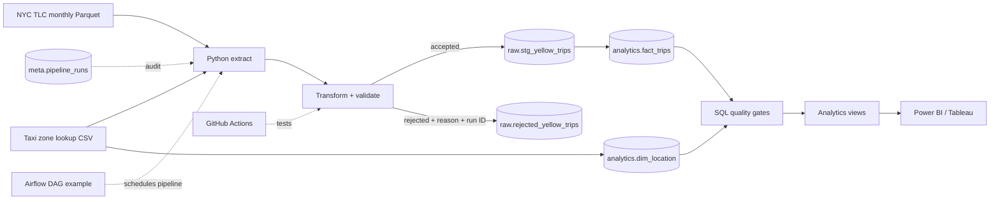

# NYC Taxi Data Engineering Platform

[](https://github.com/Miharre/nyc-taxi-data-engineering/actions/workflows/ci.yml)

An end-to-end batch data pipeline that turns monthly NYC TLC Yellow Taxi files into a repeatable, auditable PostgreSQL warehouse with data-quality controls and BI-ready analytics views.

I built this project around a practical data-engineering question: **how do I make an imperfect external dataset dependable enough for downstream analytics?** The design favors clear engineering decisions over adding tools for their own sake. The full demonstration runs locally with Docker.

## What the pipeline does

1. Downloads and caches NYC TLC Yellow Taxi Parquet data and the taxi-zone lookup.
2. Validates required fields and business guardrails in Python.
3. Splits records into accepted rows and a reason-coded quarantine table.
4. Loads accepted rows into a run-scoped staging table.
5. Builds a PostgreSQL fact table and location dimension.
6. Applies SQL data-quality gates before a run can be marked successful.
7. Exposes daily KPI, hourly-demand, and zone-performance views for BI.
8. Records run counts, timestamps, status, and failure details in an audit table.

## Architecture



## Verified local run

The repository was validated end to end with the Dockerized PostgreSQL environment using a 100,000-row January 2026 sample.

| Check | Verified result |
| --- | ---: |
| Source rows processed per run | 100,000 |
| Accepted rows per run | 94,728 |
| Quarantined rows per run | 5,272 |
| Acceptance rate | 94.73% |
| Curated fact rows after three identical runs | 94,728 |
| Unique `trip_id` values | 94,728 |
| Duplicate fact rows | 0 |
| Location dimension rows | 265 |
| Automated tests in validated run | 10/10 passed |
| Analytics views | 3 |

Three executions of the same input produced separate quarantine batches of 5,272 rows, each traceable by `pipeline_run_id`, while the curated fact table remained at 94,728 unique trips. This demonstrates the intended split between **auditable run history** and **idempotent analytical facts**.

The warehouse quality check also returned zero rows with nonpositive trip distance, nonpositive trip duration, or negative total amount.

See [`docs/validation-evidence.md`](docs/validation-evidence.md) for the measured results and validation queries.

## Data quality and quarantine

Bad records are not silently discarded. A rejected row is retained in `raw.rejected_yellow_trips` with a reason, source month, and pipeline run ID.

The validation policy checks for missing required fields, trip distance outside `(0, 100]` miles, trip duration outside `(0, 360]` minutes, negative fare/total amount, and pickup/drop-off taxi-zone IDs outside `1-265`.

These rules are project guardrails, not claims about official TLC policy. They are documented in [`docs/data-contract.md`](docs/data-contract.md).

## Idempotency and lineage

The source does not provide a single trip identifier suitable for repeat-safe loading, so the transformation derives a deterministic SHA-256 `trip_id` from selected trip attributes. The warehouse uses that key as the primary key and loads with `ON CONFLICT (trip_id) DO NOTHING`.

Accepted staging rows and rejected rows carry a pipeline run identifier. `meta.pipeline_runs` records source, accepted, and rejected counts plus run status, timestamps, and error text when a run fails.

## Warehouse and analytics

PostgreSQL separates the project into three schemas: `raw` for staging, lookup, and rejected records; `analytics` for curated models and views; and `meta` for pipeline audit history.

The analytics layer includes `analytics.v_daily_kpis`, `analytics.v_hourly_demand`, and `analytics.v_zone_performance`.

In the validated sample, JFK Airport was the highest-volume pickup zone with 7,116 trips and $537,475.72 in revenue. Friday at 13:00 was the highest-volume day/hour combination with 5,146 trips. These are observations from the validated sample, not general claims about NYC taxi demand.

## Tech stack

Python 3.11 | Pandas | PyArrow | SQLAlchemy | PostgreSQL 16 | SQL | Docker | Pytest | GitHub Actions | Apache Airflow scheduling example

## Run locally

Prerequisites: Docker Desktop and Git.

```bash
git clone https://github.com/Miharre/nyc-taxi-data-engineering.git
cd nyc-taxi-data-engineering
docker compose up -d --build
docker compose logs pipeline
```

The default container command runs a bounded 100,000-row demonstration for January 2026. The pipeline itself creates the warehouse objects, marts, and quality checks; no separate warehouse-build command is required.

Run the automated tests inside the same reproducible environment:

```bash
docker compose run --rm pipeline pytest -v
```

Verify recent runs and the fact-table row count:

```bash
make verify
```

To run without the demonstration row limit:

```bash
docker compose run --rm pipeline python -m src.pipeline --year 2026 --month 1
```

## Useful validation queries

```sql
SELECT run_id, source_rows, accepted_rows, rejected_rows,
       status, started_at, finished_at
FROM meta.pipeline_runs
ORDER BY started_at DESC;

SELECT pipeline_run_id, COUNT(*) AS rejected_rows
FROM raw.rejected_yellow_trips
GROUP BY pipeline_run_id
ORDER BY pipeline_run_id;

SELECT COUNT(*) AS total_rows,
       COUNT(DISTINCT trip_id) AS unique_trip_ids,
       COUNT(*) - COUNT(DISTINCT trip_id) AS duplicate_rows
FROM analytics.fact_trips;

SELECT * FROM analytics.v_daily_kpis ORDER BY trip_date;
SELECT * FROM analytics.v_zone_performance ORDER BY pickups DESC LIMIT 10;
```

## Airflow and CI scope

`airflow/dags/taxi_pipeline.py` is an optional deployment example that schedules the same tested Python entry point. Airflow is intentionally not required for the laptop quick start, and this repository does not claim a hosted Airflow deployment.

`.github/workflows/ci.yml` runs the Python test suite on pushes and pull requests. The workflow definition is included in the repository; its hosted status should be judged from the GitHub Actions run after publication.

## Repository map

```text
src/                  extraction, transformation, loading, pipeline entry point
sql/                  schemas, warehouse model, marts, database quality gates
airflow/dags/         optional monthly Airflow scheduling example
tests/                transformation and project-asset tests
docs/                 architecture, decisions, data contract, runbook, validation evidence
.github/workflows/     continuous integration
```

## Engineering decisions

I used PostgreSQL instead of making a cloud warehouse a prerequisite because a reviewer can reproduce the project without creating a paid account. It still demonstrates schemas, constraints, indexes, SQL modeling, audit metadata, and repeat-safe loading.

I chose batch instead of streaming because the upstream source is monthly. Adding Kafka would increase complexity without solving a source-latency problem.

I kept KPI definitions in SQL views rather than a dashboard so the semantic layer is inspectable and reusable by Power BI, Tableau, or another client.

More detail is in [`docs/decisions.md`](docs/decisions.md).

## Production extensions

This is a portfolio-scale local implementation, not a claim of production deployment. At larger scale I would add immutable object storage, source-schema drift alerts, historical anomaly thresholds, secret management, stronger database integration tests, managed orchestration, partitioned/incremental analytical storage, and operational monitoring/alerting.

## Data source

The project uses public NYC Taxi & Limousine Commission Yellow Taxi trip records and the TLC taxi-zone lookup. The extraction code points to the official TLC-hosted dataset endpoints. Upstream data quality is treated as an external contract rather than assumed to be perfect.

## Author

**Abderrahim Elallam** - Data Engineer / Data Analyst

I built this project as a portfolio case study in ingestion, data quality, warehouse modeling, orchestration, testing, and operational thinking. The implementation is intentionally compact enough that I can explain the design and tradeoffs in an interview.
