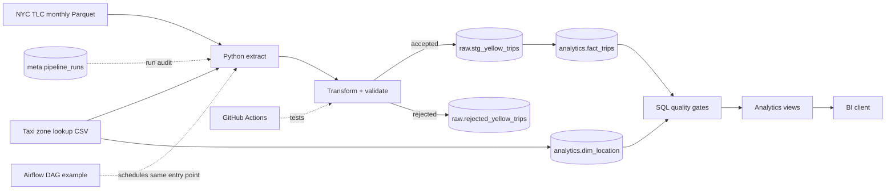

# Architecture

## Data flow

The Python entry point owns one end-to-end run. It downloads/caches source files, transforms records, attaches a run ID, writes accepted rows to run-scoped staging, appends rejected rows to quarantine, refreshes the taxi-zone lookup, builds the warehouse, creates analytics views, executes SQL quality gates, and only then records the run as successful.

A failure after metadata initialization is recorded as a failed run and re-raised so the process exits non-zero.

## Engineering choices

- Parquet remains the source format instead of being expanded to CSV.
- PostgreSQL provides a reproducible local warehouse with `raw`, `analytics`, and `meta` schemas.
- Staging is replaced per run so stale rows cannot be accidentally reprocessed.
- Quarantine is retained by run so rejected records remain auditable.
- Deterministic `trip_id` plus a primary key and `ON CONFLICT DO NOTHING` makes curated loading repeat-safe.
- SQL quality gates prevent a run from being marked successful when core integrity rules fail.
- Analytics views provide a stable semantic layer for downstream BI.
- Airflow is an optional scheduling example, not a required local dependency.
